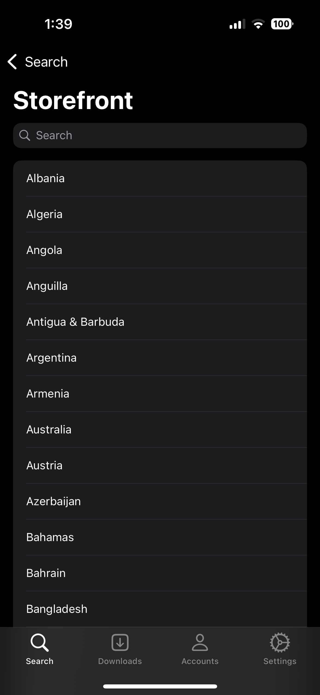
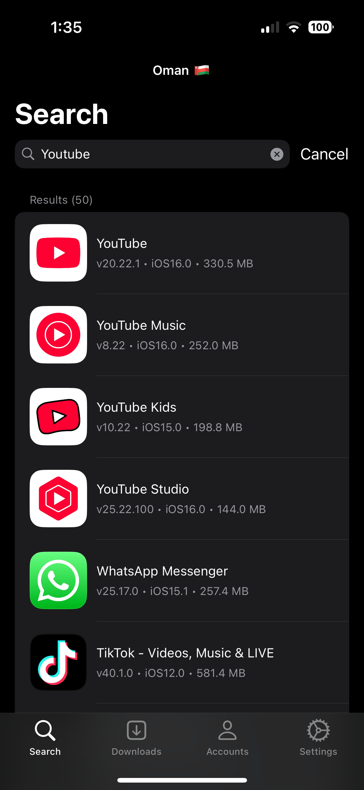
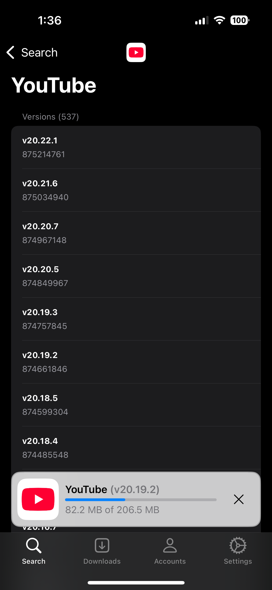
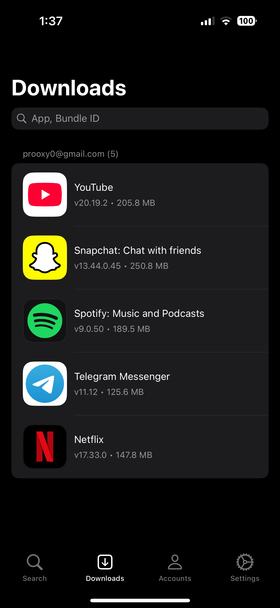
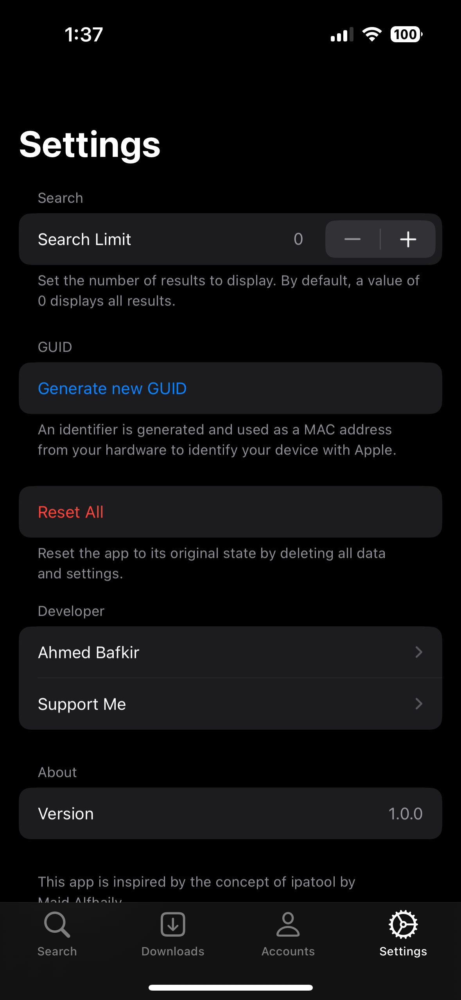

  

# DLiPA (iOS 9.0+ Compatibility Layer Rebuild)

> **Upstream Credit & Attribution**  
> This project is a legacy-compatible rebuild of **[AhmedBafkir/DLiPA](https://github.com/AhmedBafkir/DLiPA)** created by **[Ahmed Bafkir (@AhmedBafkir)](https://github.com/AhmedBafkir)**, which is inspired by the **[majd/ipatool](https://github.com/majd/ipatool)** project by **[Majd Alfhaily (@majd)](https://github.com/majd)**.  
> All credit for the original DLiPA concept, interface design, and workflow belongs to **[Ahmed Bafkir](https://github.com/AhmedBafkir/DLiPA)**.

An iOS application and web compatibility suite inspired by the [ipatool](https://github.com/majd/ipatool) project. It allows users to download, install, and share App Store applications using their Apple ID, with support for downloading older versions — no jailbreak required.

- **Original DLiPA Repository:** [https://github.com/AhmedBafkir/DLiPA](https://github.com/AhmedBafkir/DLiPA)
- **Original DLiPA Releases:** [https://github.com/AhmedBafkir/DLiPA/releases](https://github.com/AhmedBafkir/DLiPA/releases)
- **Supported iOS Versions:** **iOS 9.0+** (`armv7` 32-bit & `arm64` 64-bit via Modern Compatibility Layers) and **iOS 13.0+** (Original Native Build)

## Screenshots (Original DLiPA by Ahmed Bafkir)

  
  
  
  
  

## Features

- [x] Select from available App Store storefronts.
- [x] Search for applications with Name, Bundle ID, or App Store link.
- [x] Access your last 15 searches instantly by tapping the search bar.
- [x] Copy metadata such as Bundle ID, Application ID, and Store link.
- [x] Multiple Apple ID account support.
- [x] Purchase free App Store licenses.
- [x] Download apps as `.ipa` archives.
- [x] Download older versions of applications (`softwareVersionExternalIdentifiers`).
- [x] Download specific app versions via custom **Version ID (`externalVersionId`)**.
- [x] Separate downloads per Apple ID account (with optional "Delete account with files").
- [x] Share and install `.ipa` files on device (OTA `itms-services://` or AirDrop).
- [x] Supports non-jailbroken devices.
- [x] **iOS 9.0 – 12.5.7 Modern Compatibility Layers**:
  - `CommonCryptoBridge`: Bridges iOS 13+ `CryptoKit` (`SHA256`, `HMAC`) to `CommonCrypto` (`CC_SHA256`, `CCHmac`) for iOS 9.0+.
  - `UIKitLegacyBackport`: Bridges iOS 13+ `SwiftUI` & `.insetGrouped` tables to iOS 9+ `UITableView` & `NSLayoutAnchor`.
  - `SFSymbolsLegacyFallback`: Bridges iOS 13+ `UIImage(systemName:)` to CoreGraphics vector paths on iOS 9–12.
  - `LegacyURLSessionPipeline`: Bridges iOS 15+ `async/await` networking to `NSURLSessionDataTask` with TLS 1.2 cipher negotiation.
  - `/legacy` ES5 WebKit 601 Portal: Lightweight ES5 interface for legacy iOS 9.3.5 Mobile Safari devices.
- [x] **Automated GitHub Actions Build (`.github/workflows/build-ipa.yml`)**: Compiles, backports Mach-O `LC_BUILD_VERSION` to iOS 9.0 via `vtool`, signs with `ldid`, and publishes `.ipa` artifacts.

## Acknowledgements & Upstream Credits

- **Original Author & Repository:** [**Ahmed Bafkir — AhmedBafkir/DLiPA**](https://github.com/AhmedBafkir/DLiPA)
- **Special Thanks:** [**ipatool**](https://github.com/majd/ipatool) by **Majd Alfhaily**

## Support the Original Developer ♡

If you find DLiPA useful, please support **Ahmed Bafkir** in its continuation and development:

